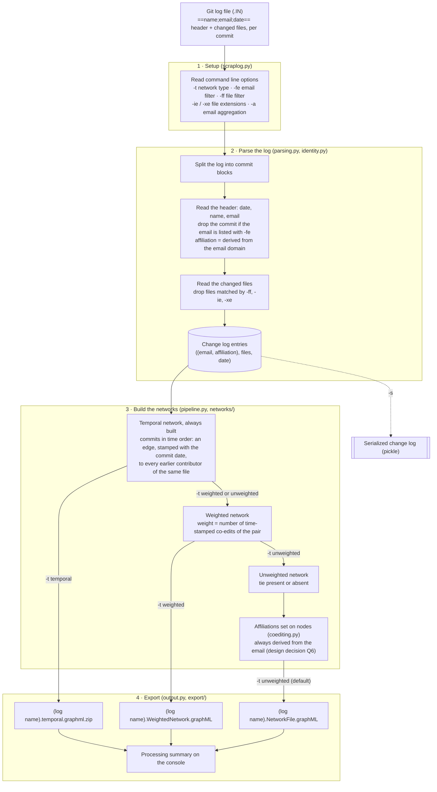

# ScrapLogGit2Net

A toolset for mining and visualizing [Git](https://git-scm.com/) repositories with [Social Network Analysis](https://en.wikipedia.org/wiki/Social_network_analysis). ScrapLogGit2Net allows its users to scrape, model, and visualize social networks based on source-code file co-edits for any given Git repository.

[](https://doi.org/10.5281/zenodo.23964329)

[](https://www.gnu.org/licenses/gpl-3.0)

[](https://github.com/jaateixeira/ScrapLogGit2Net/commits/main)
[](https://github.com/jaateixeira/ScrapLogGit2Net/issues)
[](https://www.python.org/)
[](https://github.com/jaateixeira/ScrapLogGit2Net/stargazers)
[](https://github.com/jaateixeira/ScrapLogGit2Net/actions/workflows/unit-tests.yml)
[](https://github.com/jaateixeira/ScrapLogGit2Net/actions/workflows/acceptance-tests.yml)

[]()  
[]()  


[]()
[]()  
[]()
  

  


  

[]()
[]()  

[]()
[]()
[]()

[]()
[]()  


The toolset was first developed by [Jose Apolinário Teixeira](http://users.abo.fi/jteixeir/) during his doctoral studies with some guidance from Software Engineering scholars with expertise in the mining of software repositories. The tool merits by considering both individuals and organizations. The tool maps developers to organizations by the commit email address and external [APIs](https://en.wikipedia.org/wiki/API) such as the [REST](https://docs.github.com/en/rest?apiVersion=2022-11-28) and [GraphQL](https://docs.github.com/en/graphql) ones provided by [GitHub](https://github.com/).

See [Features](#features) for what it can do.

The code was also recently (i.e., Spring 2024) made compliant with the [NetworkX is a Python package](https://networkx.org/documentation/latest/) data structures and the [Python 3.10 version](https://networkx.org/documentation/latest/) runtime, which simplified the original codebase.
For more information, see the publication and related website:

- Teixeira, J., Robles, G., & González-Barahona, J. M. (2015). Lessons learned from applying social network analysis on an industrial Free/Libre/Open Source Software ecosystem. *Journal of Internet Services and Applications*, 6, 1-27. Available open-access at [https://jisajournal.springeropen.com/articles/10.1186/s13174-015-0028-2](https://jisajournal.springeropen.com/articles/10.1186/s13174-015-0028-2).
- Website [http://users.abo.fi/jteixeir/OpenStackSNA/](http://users.abo.fi/jteixeir/OpenStackSNA/) with the obtained social networks and visualizations included [in publications by the author on the OpenStack software ecosystem](http://www.jteixeira.eu/#pub).
- Website [http://users.abo.fi/jteixeir/TensorFlowSNA/](http://users.abo.fi/jteixeir/TensorFlowSNA/) with the obtained social networks and visualizations for the TensorFlow open and cooperative project. See [https://aisel.aisnet.org/ecis2025/gov_platform/gov_platform/1/](https://aisel.aisnet.org/ecis2025/gov_platform/gov_platform/1/) for most recent publication. 

# Overview
- **Problem:** it is hard to figure out who works with whom in complex software projects.
- **Input:** a Git repository and its commit log.
- **Output:** social networks that capture who codes with whom in a repository (note that a software project can have multiple repositories): networks of developers, or of the organizations they work for, saved as GraphML files.
- **Vision:** a world where software co-production analytics put social network visualizations at the side of standard quantitative statistical data. All towards the improved management and engineering of complex software projects orchestrated on Git.

# Installation

ScrapLogGit2Net needs **Python 3.12 or newer** and **Git**. The recommended way to install it is inside a Python virtual environment, so its dependencies do not interfere with other Python projects on your computer.

## 1. Get the code
```
git clone https://github.com/jaateixeira/ScrapLogGit2Net.git
cd ScrapLogGit2Net
```

## 2. Create and activate a virtual environment

Linux and macOS:
```
python3 -m venv .venv
source .venv/bin/activate
```

Windows (PowerShell):
```
py -3 -m venv .venv
.venv\Scripts\Activate.ps1
```
(In Windows Command Prompt, use `.venv\Scripts\activate.bat` instead.)

Once activated, your prompt starts with `(.venv)`. Run `deactivate` to leave the environment.

## 3. Install ScrapLogGit2Net
```
python -m pip install --upgrade pip
python -m pip install -e .
```
This installs the dependencies and the command-line tools: `scrapLog`, `transform-nofi-2-nofo`, `nofo-graphml-network-visualizer` and the others listed in [Executable tools/scripts](#executable-toolsscripts). The scripts in the repository root (e.g. `./scrapLog.py`) keep working as before. To run the tests or contribute, also install the test dependencies: `python -m pip install -e ".[test]"`.

## 4. Check the installation
```
scrapLog --help
```
If you see the list of options, the installation worked. To run the tests, use `python -m pytest` (unit tests, needs the test dependencies) and `bash tests/acceptance-test-scripts/testScrapLog.sh` (Linux, macOS, or Windows with WSL/Git Bash). Both also run on GitHub for every push and pull request.

Next time, you only need to activate the environment again (step 2, second command) before running `scrapLog`.

## Troubleshooting
- **`ModuleNotFoundError: No module named 'tkinter'` when importing `networkx_temporal`.** Some `networkx-temporal` 1.4.x releases import `turtle`, which needs Tk. Either install Tk (Debian/Ubuntu: `sudo apt install python3-tk`; Fedora: `sudo dnf install python3-tkinter`; the python.org installers for macOS and Windows already include it) or stay on the 1.3.x series, which ScrapLogGit2Net selects by default.
- **`python3 -m venv` fails on Debian/Ubuntu.** Install the venv module with `sudo apt install python3-venv`.
- **Missing system packages on Linux.** See the file `dependencies.sh`.

# Quick start
Once installed, try ScrapLogGit2Net on the TensorFlow git log that comes with the repository (January to March 2024):
```
scrapLog -r test-data/TensorFlow/tensorFlowGitLog-first-trimester-2024.IN
transform-nofi-2-nofo tensorFlowGitLog-first-trimester-2024.NetworkFile.graphML
nofo-graphml-network-visualizer tensorFlowGitLog-first-trimester-2024.NetworkFile-transformed-to-nofo.graphML
```
1. `scrapLog` builds the network of developers who co-edited the same files: `tensorFlowGitLog-first-trimester-2024.NetworkFile.graphML` (256 developers, 3,363 ties).
2. `transform-nofi-2-nofo` turns it into a weighted network of the organizations they work for: `tensorFlowGitLog-first-trimester-2024.NetworkFile-transformed-to-nofo.graphML`.
3. `nofo-graphml-network-visualizer` draws that network: `tensorFlowGitLog-first-trimester-2024.NetworkFile-transformed-to-nofo-spring-all.png` (and `.pdf`).

To analyse your own project, see [How to use scrapLog.py](#how-to-use-scraplogpy).


# How `scrapLog.py` works
It uses the commit logs of a Git repository:
```git log --pretty=format:"==%an;%ae;%ad==" --name-only```

- %an stands for author name.
- %ae stands for author email.
- %ad stands for author date.

Then:
- It starts by identifying what source-code files were changed by whom at a given point in time.
- Then associates each file with the developers that co-edited the same source-code file.
- Then connects developers in a network. Nodes are software developers with a unique email. Edges are established if developers co-edited the same source-code file (i.e., nodes are connected by working on the same files).

Note that:
- Some manual developer email aggregation might be required as the same developers can use multiple emails.
- Software bots can also commit code, undermining your analysis of peer-to-peer collaboration.
- Co-editing some files might not be an indicator of collaboration. It's like some scholars co-authoring articles where little or no cooperation existed as expected. For example, when analyzing projects in the C programming language, the co-editing of a Makefile might not be an indicator of collaboration, but instead an indicator of coordination and/or information sharing. 

<p align="center">
  
  <br>
  <em>Illustration of how ScrapLogGit2Net models the network from Git commit logs.</em>
</p>

## The `scrapLog.py` pipeline, step by step

The diagram shows what happens when you run `./scrapLog.py -r <log>.IN`. The four numbered steps are the four calls in `main()` (`scraplog/scraplog.py`); the names in brackets are the modules that do the work.



Notes:
- Only developers with at least one co-edit become nodes (design decision Q7, see [Design decisions](#design-decisions)).
- The same input always gives byte-identical output files: nodes and edges are written in sorted order.
- Commits by emails listed with `-fe` are dropped while the log is parsed, so those developers are absent from every network type. The processing summary reports how many commits were excluded and for which emails.

# Types of networks `scrapLog.py` can build

The type of network is chosen with the `-t` / `--type-of-network` option. If you do not choose one, you get the default, `inter_individual_graph_unweighted`.

All types share the same basic model:
- **Nodes** are software developers, identified by their commit email address.
- **Affiliation** is stored as a node attribute (`affiliation`) and inferred from the email domain (e.g., `us.ibm.com` becomes `ibm`, `alumni.mit.edu` becomes `mit`, `gmail.com` becomes `gmail`). If the domain is valid but the organization cannot be determined, the affiliation is `unknown_by_ScrapLog`. Use `-a` with a JSON file such as `{"gmail": "google", "googlemail": "google"}` to merge organizations: a key must equal the organization part of the domain (case-insensitive), and the organization name is written in lower case (see the command line options below).
- **Edges** connect two developers that co-edited the same source-code file.

The types differ in how much information they keep about *how much* and *when* developers co-edited files:

| Network type (`-t`) | Edges | Output file (default name) |
|---|---|---|
| `inter_individual_graph_unweighted` (default) | Tie present or absent | `<input>.NetworkFile.graphML` |
| `inter_individual_graph_weighted` | Tie with a `weight` attribute | `<input>.WeightedNetwork.graphML` |
| `inter_individual_graph_temporal` | Time-stamped ties (who, with whom, when) | `<input>.temporal.graphml.zip` |
| `inter_individual_weighted_LOC_temporal` | Weighted by lines of code, over time | - |
| `inter_individual_graph_weighted_SUM_LOC` | Weighted by the sum of lines of code | - |

Here `<input>` is the name of the raw changelog file given with `-r`, without its last extension (e.g., `tensorFlowGitLog-first-trimester-2024.IN` gives `tensorFlowGitLog-first-trimester-2024.NetworkFile.graphML`). Use `-o` / `--output-file` to choose another file name.

## Unweighted inter-individual network (default)
The simplest and most widely used network: an undirected graph where two developers are connected if they co-edited at least one source-code file during the analyzed period. It does not tell how often or when. It is the right choice for classic Social Network Analysis such as centrality, density, components, and visualization with the `formatFilterAndViz-*` tools.

```
./scrapLog.py -r test-data/TensorFlow/tensorFlowGitLog-first-trimester-2024.IN
./scrapLog.py -r test-data/TensorFlow/tensorFlowGitLog-first-trimester-2024.IN -t inter_individual_graph_unweighted
```

## Weighted inter-individual network
Same nodes and ties as the unweighted network, but each tie carries a `weight` attribute that quantifies the collaborative relationship between two developers, so you can tell strong ties from incidental ones. It is derived from the temporal network (see `scraplog/networks/weighted.py` for the exact weighting). The weight is written to the GraphML file as an edge attribute.

```
./scrapLog.py -r test-data/TensorFlow/tensorFlowGitLog-first-trimester-2024.IN -t inter_individual_graph_weighted
```

## Temporal inter-individual network
Each tie is time-stamped with the moment of the contribution, so you can study how collaboration evolves, for instance with sliding windows or with temporal models. The network is exported as a compressed GraphML file (`.graphml.zip`) using the [networkx-temporal](https://pypi.org/project/networkx-temporal/) package. Edges are stamped with a resolution of one second. The `-tntr` / `--temporal-network-time-resolution` option is reserved for other resolutions, which are not implemented yet: any value other than `1` stops with an error.

```
./scrapLog.py -r test-data/TensorFlow/tensorFlowGitLog-first-trimester-2024.IN -t inter_individual_graph_temporal
```

Note that the temporal network is always extracted internally, as the first step of the pipeline, whatever type you request. The weighted network is then derived from it, and the unweighted network from the weighted one:

```
git log  ->  temporal network  ->  weighted network  ->  unweighted network
```

## Line-of-code networks (not available yet)
`inter_individual_weighted_LOC_temporal` and `inter_individual_graph_weighted_SUM_LOC` are accepted by the command line parser but are not yet exported by `scrapLog.py`: choosing them ends with an "Unknown network type" error. They are reserved for networks whose ties are weighted by lines of code.

## From individuals to organizations
`scrapLog.py` itself outputs networks of **individuals**. To get a network of **organizations**, in which the weighted edge between two organizations counts the relationships between their developers, pass the GraphML file to `transform_nofi_2_nofo_graphml.py`. Intra-organizational relationships are ignored in that transformation.

## Design decisions

These choices affect the networks you get, and therefore any measures computed from them.

### Q6 · A developer's affiliation always comes from their email address
The `affiliation` node attribute is always derived from the developer's commit email (`scraplog/identity.py`), when the network is created. Affiliations set by other means are not kept: the rules for turning an email into an organization live in one place, so every network built from the same log gets the same affiliations. Use `-a` to merge email domains into one organization. Tools that work on finished GraphML files, such as `deanonymize_github_users.py`, can still change affiliations afterwards.

### Q7 · Developers who never co-edit a file are left out
Only developers with at least one co-edit become nodes; a developer whose files nobody else edited is not in the network, not even as an isolated node. This holds for the temporal, weighted and unweighted networks. For example, the TensorFlow log for the first trimester of 2024 has 279 authors, of whom 256 co-edited at least one file, so its networks have 256 nodes. Keep this in mind for measures that depend on the number of nodes, such as density or normalized centralities. The same applies to networks of organizations: an organization without inter-organizational ties is not a node. To study developers who work alone, use `solo_contributors.py`.

# How to use `scrapLog.py`
You need basic skills in Git and basic skills on how to invoke Python scripts (test case scripts are implemented in bash). Knowing Python code will also help a lot. You do not need to be a programmer to use ScrapLogGit2Net, but if you are one, and find it useful, please contribute to the project.

## First, clone a Git repository
Clone the Git repository you wish to mine with Social Network Analysis. Here is the example for TensorFlow:
```
git clone https://github.com/tensorflow/tensorflow.git
cd tensorflow
```

## Second, get the Git logs for scraping
Obtain the commit logs that will be the main input for ScrapLogGit2Net. In this example, they are saved to the tensorFlowGitLog.IN file. Note that data scraping is a technique where a computer program extracts data from human-readable output coming from another program. In this case ScrapLogGit2Net will extract data coming from Git.

```
git log --pretty=format:"==%an;%ae;%ad==" --name-only > tensorFlowGitLog.IN
```

If you are lost by this point, time to learn about Git.
```
man git
man git log
```

Congratulations you should have your raw data ready for analysis with ScrapLogGit2Net.

Look at your INPUT data. As you can see from the following 4 April 2024 sample data from TensorFlow, you get timestamped data on who changed what files. Note that each commit starts with a header line wrapped in `==` (name, email and date with timezone offset, separated by `;`), followed by the files it changed. The timezone offset (e.g., `-0700`) is required by the parser. Also note that gardener@tensorflow.org is a bot, not a developer that directly commits code.

```
==A. Unique TensorFlower;gardener@tensorflow.org;Wed Apr 3 22:39:37 2024 -0700==
tensorflow/core/tfrt/saved_model/tests/BUILD
tensorflow/core/tfrt/saved_model/tests/saved_model_test.cc

==Doyeon Kim;doyeonkim@google.com;Wed Apr 3 20:54:06 2024 -0700==
tensorflow/compiler/mlir/lite/quantization/stablehlo/quantization.cc
tensorflow/compiler/mlir/quantization/stablehlo/python/integration_test/quantize_model_test.py
tensorflow/compiler/mlir/quantization/stablehlo/python/quantization.py
tensorflow/compiler/mlir/quantization/stablehlo/quantization_config.proto

==Jiyoun (Jen) Ha;jiyounha@google.com;Wed Apr 3 18:50:32 2024 -0700==
tensorflow/lite/core/subgraph.cc

==Doyeon Kim;doyeonkim@google.com;Wed Apr 3 17:46:07 2024 -0700==
tensorflow/compiler/mlir/lite/quantization/stablehlo/BUILD
tensorflow/compiler/mlir/lite/quantization/stablehlo/quantization.cc
```

What ScrapLogGit2Net does is to parse these timestamps and associate developers that co-edited the same source-code file in a social network. If two developers co-edit the same source-code file over time, we can assume that they cooperate with each other. A bit like scientists that co-author papers.

Note that this example covers almost 10 years of commit logs in the TensorFlow project. It might be wise to narrow down the time window you want to analyze.

```
git log --pretty=format:"==%an;%ae;%ad==" --name-only
```

In the following example, you are checking commit logs between 1st and 4th of April 2021:
```
git log --since='Apr 1 2021' --until='Apr 4 2021' --pretty=format:"==%an;%ae;%ad==" --name-only
```

And this example you check what developers did on 1st of April 2024:
```
git log --since='Mar 31 2024' --until='Apr 1 2024' --pretty=format:"==%an;%ae;%ad==" --name-only
```

Finally, the last example goes to the TensorFlow repository and gets the data to study the first trimester for 2024:
```
cd tensorflow && git log --since='Jan 1 2024' --until='Mar 31 2024' --pretty=format:"==%an;%ae;%ad==" --name-only > tensorFlowGitLog-first-trimester-2024.IN
```

- Now let's analyze some data.

## Scrape the data - Get basic statistics and social networks
```
./scrapLog.py  --raw  test-data/TensorFlow/tensorFlowGitLog-first-trimester-2024.IN
```
or
```
python3 scrapLog.py  -r test-data/TensorFlow/tensorFlowGitLog-first-trimester-2024.IN
```

By default, if all goes well, you get a "NetworkFile.graphML" file prefixed with the data input filename (e.g., tensorFlowGitLog-first-trimester-2024.NetworkFile.graphML) capturing the unweighted social network of individuals. Congrats. You collected social network data ready for analysis. Use the `-t` option to get weighted or temporal networks instead (see [Types of networks](#types-of-networks-scraplogpy-can-build)).

# Executable tools/scripts 

| Script | What it does | Documentation |
|---|---|---|
| **`scrapLog.py`** | The core tool. Mines a raw Git log and builds a collaboration network of developers that co-edited the same source-code files. Developers are identified by email, and their organization is inferred from the email domain. See [Types of networks](#types-of-networks-scraplogpy-can-build). | [scrapLog.md](docs/tools/scrapLog.md) |
| **`transform_nofi_2_nofo_graphml.py`** | Transforms a network of individuals (nofi) into a weighted network of organizations (nofo). The weight of an edge between two organizations is the number of developers that worked together across them (e.g., Nokia and Apple with three developers co-editing the same files gives weight 3). Intra-organizational ties are ignored. | [transform_nofi_2_nofo_graphml.md](docs/tools/transform_nofi_2_nofo_graphml.md) |
| **`deanonymize_github_users.py`** | Improves a GraphML file by resolving GitHub `noreply` emails and affiliations through the GitHub REST API. Needs a GitHub token in the `GITHUB_TOKEN` environment variable or in a `config.ini` file. | [deanonymize_github_users.md](docs/tools/deanonymize_github_users.md) |
| **`formatFilterAndReport-nofi-GraphML.py`** | Reports metrics for a network of **individuals**: overview of the network, top organizations and top individuals. | [formatFilterAndReport-nofi-GraphML.md](docs/tools/formatFilterAndReport-nofi-GraphML.md) |
| **`formatFilterAndReport-nofo-GraphML.py`** | Reports metrics for a network of **organizations**, with focus on the top firms. | [formatFilterAndReport-nofo-GraphML.md](docs/tools/formatFilterAndReport-nofo-GraphML.md) |
| **`nofi_graphml_network_visualizer.py`** | Formats, filters, and visualizes a network of **individuals**. Nodes are colored by organizational affiliation and sized by centrality. | [nofi_graphml_network_visualizer.md](docs/tools/nofi_graphml_network_visualizer.md) |
| **`nofo_graphml_network_visualizer.py`** | Formats, filters, and visualizes a weighted network of **organizations**. Edge thickness maps to weight and nodes are colored by affiliation. | [nofo_graphml_network_visualizer.md](docs/tools/nofo_graphml_network_visualizer.md) |
| **`compare-set-nofi-GraphML.py`** | Compares several networks of individuals (e.g., one per year or release) by plotting standard network metrics side by side: nodes, edges, isolates, average degree, density, average clustering, connected components, and size of the largest component. | [compare-set-nofi-GraphML.md](docs/tools/compare-set-nofi-GraphML.md) |
| **`compare-two-nofi-GraphML-metrics.py`** | Same metrics and plot as above, plus a summary table in the console. | [compare-two-nofi-GraphML-metrics.md](docs/tools/compare-two-nofi-GraphML-metrics.md) |
| **`solo_contributors.py`** | Counts, per study period, the developers that touched *only* files that nobody else touched. These developers are invisible in a co-editing network. Also lists every solo-edited file with its sole developer. | [solo_contributors.md](docs/tools/solo_contributors.md) |
| **`scrap_repo_repositories_logs.py`** | Batch miner (experimental). Intended to mine the logs of a whole repository or directory, filtering by year range or release names, and to produce networks for every branch. | [scrap_repo_repositories_logs.md](docs/tools/scrap_repo_repositories_logs.md) |


# Known issues on mining Git repositories from a network perspective with ScrapLogGit2Net

ScrapLogGit2Net shines at mining Git repositories with Social Network Analysis because it takes a multi-level perspective. It tries to capture and model collaboration in terms of source-code file co-editing in terms of both individuals and organizations. It does that by trying to assign an organization attribute to each developer. An organization should be a firm, research institute, university, etc). However, it does it by looking at the email that developers set when pulling code contributions to the repository.

* If John pulls the code with john@us.ibm.com, John gets attributed with IBM.
* If Silvia pulls the code with silvia@amazon.com, Silvia gets attributed Amazon.com
* If Gregor pulls with gregor@gmail.com, Gregor gets associated with Gmail.  

The approach works well, most of the time. But there are known issues that should be mitigated. Often by hard work, where data needs to be "cleaned" manually or using semi-automated approaches whenever possible.

## Getting firm attributes from emails  


If a developer has two or more organization emails (e.g., works part-time for two organizations). Should it be treated as two developers!!  Or merged into one? This might require additional investigation on the developer and its contributions to figure out the best way to model the social network.
If a developer changes organization (e.g., changed email), by default ScrapLogGit2Net models them as another developer. You might want to model it in another way.
If a developer contributes with a personal email account (Gmail, Outlook) and with a firm account (e.g., IBM, Amazon) during the same period, what should be done? ScrapLogGit2Net associates the developer with Gmail. But it might make sense to associate them with the firm they also commit for. Should contributions submitted with personal-use email services (e.g., Gmail, Hotmail, Outlook) be considered as personal contributions that have nothing to do with an organization the developer works with?

When associating emails with developers, and developers with firms, it is a good approach to find suspicious similarities in the strings identifying actors in the network. The Python package [strsimpy](https://pypi.org/project/strsimpy/) implements many algorithms for string similarity. The names 'George Tony' and 'George Toony' have a very high string similarity score, so they are probably the same person. Test for similarity in names and emails to enhance the robustness of the social network model.

### A developer can have multiple emails

There are many ways to deal with developers that use several emails. The simplest one is to use the approach by [Augustina Ragwitz (2017)](https://rstudio-pubs-static.s3.amazonaws.com/316662_7181d6efdd584358b935f7e444efb152.html), the
first email address found in the commit log for an author is then the authoritative one. According to her:
  > While other methods should be explored and compared for better accuracy, this is sufficient to identify unique authors.

If the Git repository is hosted on GitHub, you can dig and solve this issue with more confidence by assessing the developer's profiles with your favourite programming language using the GitHub GraphQL API  (see  [https://docs.github.com/en/graphql](https://docs.github.com/en/graphql))  or the GitHub  REST API (see [https://docs.github.com/en/rest](https://docs.github.com/en/rest)).  For that, you will need the necessary permission with a GitHub account and an authentication token.  For Python lovers, PyGithub  is readily available  with methods that interface with the GitHub REST API
(see [https://pygithub.readthedocs.io/en/stable/introduction.html](https://pygithub.readthedocs.io/en/stable/introduction.html)).

Note, however, that GitHub GraphQL API was designed in a way that you can retrieve relational graph-oriented data more efficiently from large social networks.

If the Git repository is not hosted on GitHub, you can use the approach by [Teixeira, Leppänen and Hyrynsalmi (2020)](https://arxiv.org/pdf/2106.09329) that used pattern-matching techniques with regular expressions to identify unique names and emails. Note that in their study of code reviews on the Linux Kernel, they adopted a strictly extra-relational approach: individuals are identified by their real names, while all affiliations are based on explicit data extraction from the domain names in individuals’ e-mail addresses. ScrapLogGit2Net gets developers' IDs and their affiliations from e-mail addresses, simply ignoring their names.

### A developer can hide their email

Most developers do not hide their email from the git logs. Like scientists in their articles, they want to keep their names as authors or contributors. However, they can remain anonymous or simply do not want to be contacted or avoid spam. This is popular since GitHub started allowing the association of pseudo email addresses in the format [8 digit number]+[username]@users.noreply.github.com that are still associated with their GitHub profile. For example, a git commit from Ruslan Inovic <rroinov@gmail.com> might appear as <608192+rosmanov@users.noreply.github.com>. See GitHub documentation on the issue at [GitHub Docs](https://docs.github.com/en/account-and-profile/setting-up-and-management-your-personal-account-on-github/managing-email-preferences/setting-your-commit-email-address#about-commit-email-addresses). Once again using the GitHub GraphQL API  (see  [https://docs.github.com/en/graphql](https://docs.github.com/en/graphql))  or the GitHub  REST API (see [https://docs.github.com/en/rest](https://docs.github.com/en/rest)) would allow mapping the @users.noreply.github.com with developers or other emails used by them. Note that once a developer commits code with an email, it will always be associated with them on GitHub. When developers set commits to be signed with a no-reply email, they only affect future commits, not the past recorded ones.

## Some collaborative edges are missed with longitudinal segmentation

As pointed out by [Teixeira et al. (2015)](https://link.springer.com/article/10.1186/s13174-015-0028-2), when studying code-collaboration as a synchronous behaviour happening across different time windows (release after release or year after year), you will miss some collaboration edges between two developers who contributed to the same file that started before the time-window opened for analysis or did not end before the time-window closed. See [https://link.springer.com/article/10.1186/s13174-015-0028-2/figures/3](https://link.springer.com/article/10.1186/s13174-015-0028-2/figures/3).

A way to quantify this issue is to first analyze all the historical data. From day 0 to the last day save the edges. Then conduct the analysis in segments (e.g., year after year, release after release, etc). Then see how many edges there are in the network from all the time that were not captured by the time-limited analysis. 0 is ideal. But expect a few. Given that people tend to drop coding efforts before Xmas and New Year, or before releasing a new version (as they concentrate efforts on stabilizing over developing new features), the impacts on the model validity are very small.

# `scrapLog.py` command line options for advanced use

- Use serialized changelogs so you don't need to use raw Git logs every time (speeds things up)
- Provide a configuration file with emails (aka developers) that should be ignored. Handy for ignoring bots that commit code
- Use verbose mode for debugging and testing

```
▶ Executing: scrapLog.py --help
usage: scrapLog.py [-h] [-l LOAD] -r RAW [-s SAVE] [-fe FILTER_EMAILS] [-ff FILTER_FILES] [-ie EXT [EXT ...]] [-xe EXT [EXT ...]] [-a AGGREGATE_EMAIL_PREFIXES]
                   [-t {inter_individual_graph_unweighted,inter_individual_graph_weighted,inter_individual_graph_temporal,inter_individual_weighted_LOC_temporal,inter_individual_graph_weighted_SUM_LOC}]
                   [-tntr TEMPORAL_NETWORK_TIME_RESOLUTION] [-o OUTPUT_FILE] [-v] [-d] [-st]

Scrap git changelog to create networks/graphs for research purposes

options:
  -h, --help            show this help message and exit
  -l, --load LOAD       load a change log saved with -s. Not implemented yet: stops with an error
  -r, --raw RAW         processes from a raw git changelog
  -s, --save SAVE       also save the parsed change log to this file (Python pickle)
  -fe, --filter-emails FILTER_EMAILS
                        ignores the emails listed in a text file (one email per line)
  -ff, --filter-files FILTER_FILES
                        ignores the files listed in a text file (one file per line). Lines can be exact paths (src/main.py) or
                        wildcard patterns (*.md, docs/*); blank lines and lines starting with # are ignored
  -ie, --include-only-with-file-extensions EXT [EXT ...]
                        only process files with these extensions (e.g. -ie .py .cpp .cu)
  -xe, --exclude-all-with-file-extensions EXT [EXT ...]
                        skip files with these extensions (e.g. -xe .json .html .php)
  -a, --aggregate-email-prefixes AGGREGATE_EMAIL_PREFIXES
                        JSON file mapping the organization part of email domains to an organization name (exact,
                        case-insensitive match; e.g. {"gmail": "google", "googlemail": "google"})
  -t, --type-of-network {inter_individual_graph_unweighted,inter_individual_graph_weighted,inter_individual_graph_temporal,inter_individual_weighted_LOC_temporal,inter_individual_graph_weighted_SUM_LOC}
                        Type of network to generate (default: inter_individual_graph_unweighted)
  -tntr, --temporal-network-time-resolution TEMPORAL_NETWORK_TIME_RESOLUTION
                        Temporal network time resolution in seconds. Only 1 (the default) is
                        implemented so far; other values stop with an error
  -o, --output-file OUTPUT_FILE
                        creates a network/graph graphml file with the given name
  -v, --verbose         Increase verbosity level (use -v, -vv, or -vvv)
  -d, --debug           Enable debug output
  -st, --strict         strict validation mode - fail on validation errors
```

For example, the following command

```
./scrapLog.py -fe test-configurations/TensorFlow/TensorFlowBots.txt -r test-data/TensorFlow/tensorFlowGitLog-first-trimester-2024.IN --verbose
```

scrapes the Git log in the test-data/TensorFlow/tensorFlowGitLog-first-trimester-2024.IN input file, ignores emails listed in the test-configurations/TensorFlow/TensorFlowBots.txt file, and prints debug information in a verbose way. By default, it also creates a
network file in the standard XML-based format GraphML.

## Ignoring files (`-ff`)

Co-editing some files (e.g., build files, changelogs) can indicate coordination rather than collaboration. To leave such files out of the network, list them in a text file and pass it with `-ff`:

```
./scrapLog.py -r test-data/TensorFlow/tensorFlowGitLog-first-trimester-2024.IN -ff test-configurations/TensorFlow/TensorFlowIgnoreBuildFiles.txt
```

The filter file has one entry per line:
- An exact path as it appears in the Git log, e.g. `tensorflow/core/BUILD`.
- A wildcard pattern: `*` matches any characters (including `/`), `?` matches one character, and `[abc]` matches one of the listed characters. For example, `*.md` ignores Markdown files in every directory and `docs/*` ignores everything under `docs/`. Matching is case-sensitive.
- Blank lines and lines starting with `#` are ignored.

Commits that only touch ignored files are skipped. If the filter file is missing or cannot be read, scrapLog.py exits with an error.

# Features

## Available features
- **Networks of developers** who co-edited the same files, in three types: unweighted, weighted (weight = number of time-stamped co-edits of the pair) and temporal (each tie stamped with the commit date). See [Types of networks](#types-of-networks-scraplogpy-can-build).
- **Networks of organizations.** Affiliations are inferred from email domains (`-a` merges domains into one organization), and `transform_nofi_2_nofo_graphml.py` turns a network of developers into a weighted network of organizations; the weight is the number of inter-organizational relationships, and intra-organizational ones are ignored.
- **Filters.** Ignore developers by email, e.g. bots (`-fe`, applied to every network type); ignore files by path or wildcard pattern (`-ff`); keep or drop file extensions (`-ie`, `-xe`).
- **Export** to [GraphML](http://graphml.graphdrawing.org/), with affiliation attributes; temporal networks are exported as compressed GraphML.
- **Visualization** of networks of developers and of organizations: nodes colored by organization and sized by centrality, in circular and spring layouts.
- **Reports and comparisons.** Excel reports on networks of developers and of organizations, comparison of networks across periods, developers who only worked alone (`solo_contributors.py`), and resolution of GitHub `noreply` emails (`deanonymize_github_users.py`).
- **Reproducible output.** The same input gives byte-identical output files.
- **Saving the parsed change log** with `-s` (loading it back with `-l` is not implemented yet).
- **Verbose and debug output** (`-v`, `-vv`, `-d`).
- **Tested.** Unit and acceptance tests run on GitHub for every push and pull request (see [Testing](#testing)).

## To implement (volunteers welcome)
- Account for co-authorships made explicit with the 'Co-authored-by:' string on the trailer of the commit's message [see documentation on https://docs.github.com/en/pull-requests](https://docs.github.com/en/pull-requests/committing-changes-to-your-project/creating-and-editing-commits/creating-a-commit-with-multiple-authors). Opens the way for triangulation.
- Account for commits on behalf of organizations using the 'on-behalf-of: @ORG NAME[AT]ORGANIZATION.COM' string on the trailer of the commit's message [see documentation on https://docs.github.com/en/pull-requests](https://docs.github.com/en/pull-requests/committing-changes-to-your-project/creating-and-editing-commits/creating-a-commit-on-behalf-of-an-organization).
- Possibility to add an argument pointing to a file with REGULAR EXPRESSIONS to capture emails to ignore (e.g., ignoring developers from a given company).
- Possibility to add an argument pointing to a file that aggregates different emails used by a different individual (e.g., John uses <John@ibm.com> and <John@gmail.com>).
- Possibility to add an argument pointing to a file that aggregates different emails used by different organizations (e.g., @ibm.com, @linux.vnet.ibm.com, @us.ibm.com, @cn.ibm.com all map IBM).
- Possibility to export both networks at the individual and organizational level (networks of individuals affiliated with organizations, and networks of organizations) during scraplog execution from Git log data.
- Possibility to limit analysis to n top contributors (organization with most nodes).
- Report stats on the files connecting people the most (handy for identifying outliers).
- Reporting analysis in LaTeX, Markdown, HTML, and text files. Should include quantitative metrics (e.g., n. commits, n. lines of code per dev, most co-edited files) and relational metrics (e.g., centrality, density).
- Support for other network formats besides GraphML (see [https://socnetv.org/docs/formats.html](https://socnetv.org/docs/formats.html)).
- Support for community detection.
- Use config files as there are already so many parameters.
- Integrate with the [TNM Tool for Mining of Socio-Technical Data from Git Repositories](https://github.com/JetBrains-Research/tnm). Cool, advanced, research-based but coded in Java. See [TNM tool presentation at MSR (2021) conference](https://www.youtube.com/watch?v=-NXaY8zTEOU).
- Integrate with the [git2net tool that also facilitates the extraction of co-editing networks from Git repositories.](https://github.com/gotec/git2net). Cool, advanced, research-based and also coded in Python. Has a more sophisticated approach to edges based on entropy and offers disambiguation features.
- Integrate with https://www.logo.dev API for allowing users to use company logos.
- Publish the Python package on PyPI (it can already be installed from a clone with `pip install -e .`).

# Research datasets

The data behind Teixeira, J., Ahmed, S. S., Laine-Kronberg, A., Mezei, J., & Smailhodzic, E. (2025). *Towards understanding open and coopetitive platform ecosystems: The case of TensorFlow*. ECIS 2025 (TensorFlow git logs, co-editing networks, visualizations and an automatic report) is archived on Zenodo: **https://doi.org/10.5281/zenodo.24083489**

The data behind Teixeira, J. (2026). *Lessons Learned from a Governance Transition in Deep Learning Ecosystems*. ICIS 2026 (PyTorch, TensorFlow, JAX and Chainer data) is archived on Zenodo: **https://doi.org/10.5281/zenodo.22284204**

The data behind Teixeira, J., Ahmed, S. S., & Vuori, N. (2026). *Exploring the Roles of Non-Commercial Organizations in Open and Coopetitive Ecosystems: The Case of TensorFlow*. ICIS 2026 is archived on Zenodo: **https://doi.org/10.5281/zenodo.22282883**


# How to cite
If you use ScrapLogGit2Net in your research, please cite the software. GitHub's "Cite this repository" button (from `CITATION.cff`) gives the reference in APA and BibTeX formats.

- All versions (resolves to the latest release): [10.5281/zenodo.23964329](https://doi.org/10.5281/zenodo.23964329)
- Release v1.0 ("alvarinho"): [10.5281/zenodo.23964330](https://doi.org/10.5281/zenodo.23964330)

The way ScrapLogGit2Net builds networks from git logs is described in:

- Teixeira, J., Robles, G., & González-Barahona, J. M. (2015). Lessons learned from applying social network analysis on an industrial Free/Libre/Open Source Software ecosystem. *Journal of Internet Services and Applications*, 6, 1-27. https://doi.org/10.1186/s13174-015-0028-2

# Testing
Install the test dependencies first (`python -m pip install -e ".[test]"`), then run from the repository root:

- **Unit tests:** `python -m pytest`. Add `-rs` to see why some tests are skipped (planned features).
- **Acceptance tests:** bash scripts that run the tools on the small logs in `test-data/` and check the networks they produce:
  ```
  bash tests/acceptance-test-scripts/testScrapLog.sh
  bash tests/acceptance-test-scripts/testScrapLogTemporalNetworks.sh
  bash tests/acceptance-test-scripts/ExtensionFiltering/test_extension_filtering.sh
  ```
  They need `xmllint` (Debian/Ubuntu: `sudo apt install libxml2-utils`) and `unzip`.

As of November 2026 there are 218 unit tests in 16 files (212 run, 6 are skipped because they describe planned features) and 21 acceptance test cases: 12 in `testScrapLog.sh`, 4 in `testScrapLogTemporalNetworks.sh` and 5 in `test_extension_filtering.sh`. A fourth script, `test-nofi-2-nofo-transformer.sh` (3 cases), is not run automatically while the GraphML schema it validates against (graphml.graphdrawing.org) is offline.

Both the unit tests and the three acceptance scripts run on GitHub Actions for every push and every pull request into `main` (see the badges at the top). See [tests/test_guide.md](tests/test_guide.md) for how to write new tests.

# Contributing
Please create a new branch for any new feature. Branch or fork, code, test, then pull request. See  [docs/CONTRIBUTING.md](docs/CONTRIBUTING.md) for our contribution guide. Please refer also to [the GitHub guide on how to contribute to a project](https://docs.github.com/en/get-started/exploring-projects-on-github/contributing-to-a-project).

Note you should not break the test runner bash script (testScrapLog.sh) that runs ScrapLogGit2Net against test-data and compares with the expected output. You might need to change the test runner to comply with new developments.

Jose Teixeira, currently the only maintainer, will review and merge pull requests, publish changes in the [GitHub releases](https://github.com/jaateixeira/ScrapLogGit2Net/releases), acknowledge the contributions, and work on documentation in free time from work.

# Contributors
- Jose Teixeira
- Syed Ahmed
- Claude (Anthropic), AI coding assistant
- DeepSeek, AI coding assistant

# Acknowledgments
Åbo Akademi Library for financing a Master student during the summer of 2024 to contribute to the project as an open-science initiative. 

# Maintainers  
- Jose Teixeira

# License
GNU General Public License v3.0

